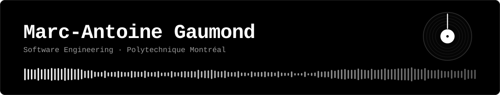

Hi, I'm Marc-Antoine (Marco). I study Software Engineering at Polytechnique Montréal and I'm a backend developer at Hack4Impact Polytechnique. I like fullstack work, AI/ML, system architecture, and figuring out how algorithms actually work. Outside of school I mostly build tools I'd use myself.

  
  
  
  

### Projects

### Stack

  
  
  
  
  
  
  
  
  
  
  
  
  
  
  
  

Always building, learning, and experimenting with new ideas.
